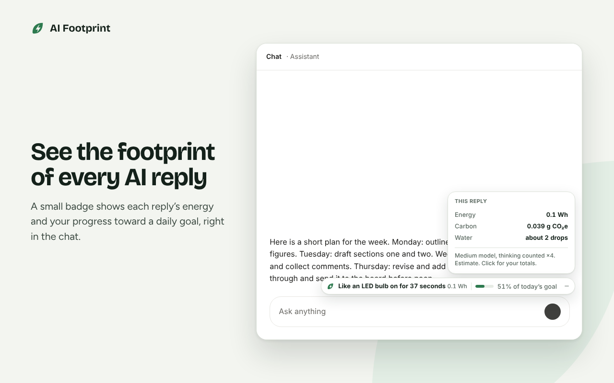
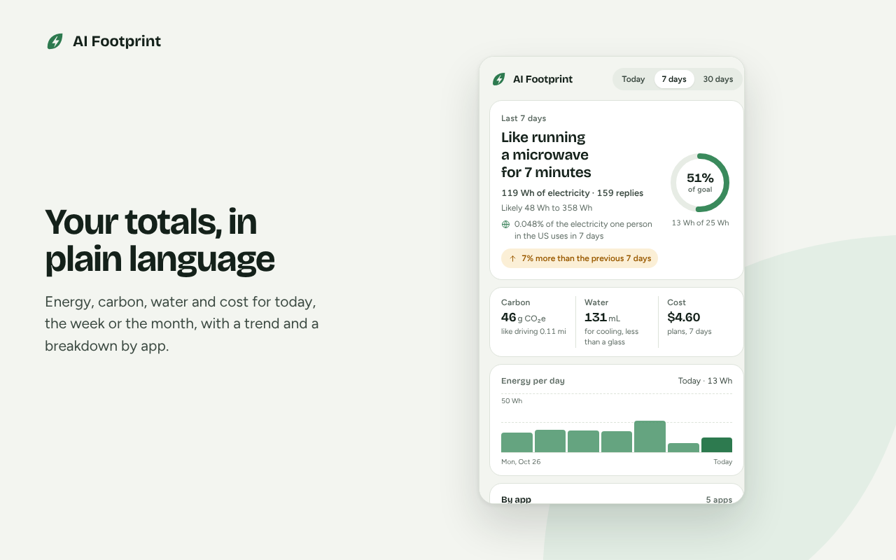
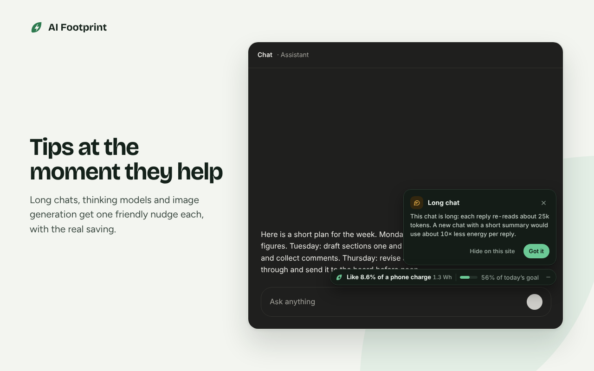
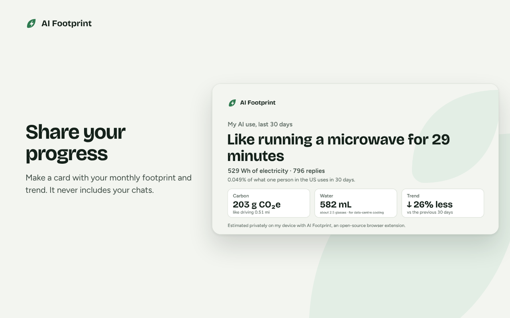
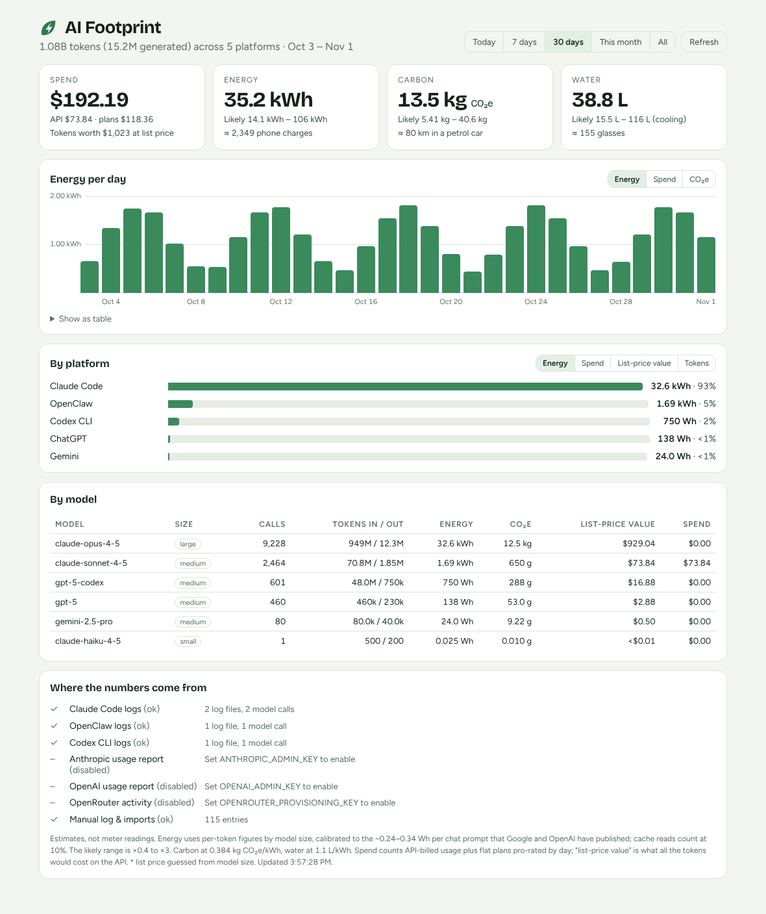

<p align="center">
  <picture>
    <source media="(prefers-color-scheme: dark)" srcset="brand/logo-dark.png" />
    
  </picture>
</p>

<p align="center"><b>The energy, carbon, water and cost behind every AI reply, put in local perspective.</b><br/>Private by design. Open source. Works wherever you use AI.</p>

<p align="center">
  <a href="https://github.com/rishinkalra/ai-footprint/actions/workflows/ci.yml"></a>
  <a href="LICENSE"></a>
  <a href="METHODOLOGY.md"></a>
</p>

<p align="center"></p>

AI is becoming part of everyday work, but its footprint is invisible. AI Footprint makes it visible with honest, open estimates you can check yourself, and with small nudges toward lighter habits. Everything runs on your own device.

## Two parts, one method

| | For | What it does |
|---|---|---|
| **[Browser extension](extension/)** | Anyone using AI chat in a browser | Measures each reply on ChatGPT, Claude, Gemini, Perplexity, Microsoft Copilot, DeepSeek, Le Chat and Grok. Shows a small badge in the chat, a popup with your totals, and tips at the moment they help. |
| **[Dashboard](dashboard/)** | Developers, power users, teams | Reads Claude Code, Codex CLI and OpenClaw logs, Anthropic / OpenAI / OpenRouter usage reports, and ChatGPT / Claude.ai exports. Shows money, energy, carbon and water for any date range. The extension can sync to it. |

Both use the same [open methodology](METHODOLOGY.md); tests keep their figures identical.

<table>
  <tr>
    <td width="50%"></td>
    <td width="50%"></td>
  </tr>
  <tr>
    <td></td>
    <td></td>
  </tr>
</table>

## What a number means
- **A typical AI chat reply uses about 0.3 Wh**, roughly what a laptop uses in a few seconds.
- **It adds up fast.** Long chats, thinking models, generated images and agentic coding can each cost 10–1000× more.
- **Estimates have wide error bars**, so we always show a likely range (0.4× to 3×).

**Local perspective.** The same 10 Wh is 2% of a day's electricity for one person in Nigeria, and 0.02% in Canada. So the extension:
- compares your AI use with electricity use where you live;
- uses miles or kilometres as people do there;
- lets you choose whose grid the carbon figure is based on.

**In plain words, in your language.** The badge and popup lead with something familiar. In India that's "Like a ceiling fan running for 1.6 hours", in the US "Like running a microwave for 6 minutes", in the UK "Like boiling water for 4.8 cups of tea". The number sits underneath. Every screen is in English, Hindi and Spanish, and more languages are welcome.

**Correct formulas.** The estimates account for:
- prompt caching in follow-ups;
- languages that need more tokens per character;
- hidden reasoning in thinking models.

Each rule has a worked example in [METHODOLOGY.md](METHODOLOGY.md), and each example is also a test.

## Private by design
- **Counts, never content.** The extension measures how long messages are. It never stores or sends what you type or what the AI says.
- **Stays on your device.** No account, no analytics, no server. Sync to a dashboard is off unless you turn it on, and then it covers only the address you enter.
- **Checkable.** It's all here, in plain JavaScript with no build step. See [PRIVACY](extension/PRIVACY.md).

## Quick start

**Browser extension** for Chrome, Edge, Brave, Arc, Opera and Firefox. Store listings are coming; until then:
1. Download the latest zip from **[Releases](https://github.com/rishinkalra/ai-footprint/releases/latest)** and unzip it.
2. **Chrome-based browsers:** open `chrome://extensions`, turn on **Developer mode**, click **Load unpacked** and choose the unzipped folder.
3. **Firefox or Safari (Mac):** see [extension/README.md](extension/README.md#develop). Safari uses a one-command installer.

**Dashboard**
```bash
cd dashboard
npm install
npm start                          # http://127.0.0.1:3100/ai-footprint/
npx ai-footprint summary 30d       # or from the terminal
npx ai-footprint import ~/Downloads/conversations.json   # ChatGPT or Claude.ai export
```

## Contributing
You don't need to be a developer: reporting a site that stopped working, or a better data source, helps just as much. See [CONTRIBUTING.md](CONTRIBUTING.md), our [Code of Conduct](CODE_OF_CONDUCT.md) and [Security policy](SECURITY.md).

## License and credits
- **Code:** [Apache License 2.0](LICENSE).
- **Name and logo:** not covered by the licence; see [TRADEMARKS.md](TRADEMARKS.md) and the [brand kit](brand/).
- **Fonts:** Bricolage Grotesque and Figtree (SIL Open Font License).
- **Country data:** Ember, via Our World in Data (CC BY 4.0).

Full attributions are in [NOTICE](NOTICE).
