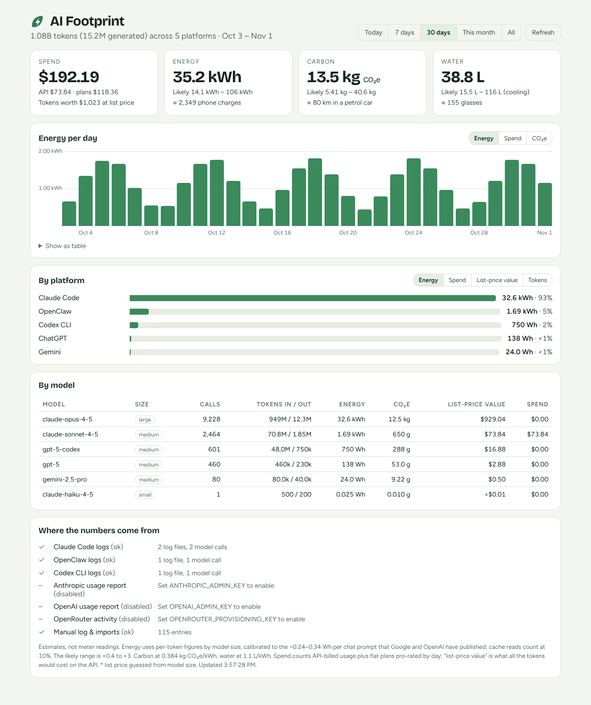

<picture>
  <source media="(prefers-color-scheme: dark)" srcset="../brand/logo-dark.png" />
  
</picture>

# Dashboard



A small Node server and CLI that add up the **money, energy, carbon and water** behind your AI usage, across every platform you use. It runs on your own machine. The methodology is in [../METHODOLOGY.md](../METHODOLOGY.md).

```bash
npm install
npm start              # http://127.0.0.1:3100/ai-footprint/   (?embed=1 for a compact card)
npx ai-footprint summary 30d
```

## Where usage comes from

| Platform | How | Setup |
|---|---|---|
| Claude Code | `~/.claude/projects/**/*.jsonl` | none |
| Codex CLI | `~/.codex/sessions/**/rollout-*.jsonl` | none |
| OpenClaw | `~/.openclaw/agents/*/sessions/*.jsonl` | none |
| Anthropic API | Admin usage report | `ANTHROPIC_ADMIN_KEY` (`sk-ant-admin…`) |
| OpenAI API | Organization usage API | `OPENAI_ADMIN_KEY` |
| OpenRouter | Activity API (real cost) | `OPENROUTER_PROVISIONING_KEY` |
| ChatGPT / Claude.ai apps | Data export import | `npx ai-footprint import conversations.json` |
| Browser chat apps | The [extension](../extension/) with sync on | `AI_FOOTPRINT_INGEST_KEY` |
| Anything else | `POST /ai-footprint/api/events`, or `npx ai-footprint log …` | `AI_FOOTPRINT_INGEST_KEY` |
| Flat-fee plans | `subscriptions` in config | config file |

When a provider report is connected, local log rows billed to the same API account are dropped, so nothing is counted twice. Usage on a subscription (e.g. Claude Code on a Max plan) still comes from the logs.

## Logging usage over HTTP
```bash
curl -X POST http://127.0.0.1:3100/ai-footprint/api/events \
  -H "x-footprint-key: $AI_FOOTPRINT_INGEST_KEY" -H 'Content-Type: application/json' \
  -d '{"platform":"gemini","model":"gemini-2.5-pro","prompts":12}'
```

**Fields:**
- **What:** `platform`, `model`.
- **When:** `date` or `ts`.
- **How much:** `prompts` (or `requests`), `inputTokens`, `outputTokens`, `cacheReadTokens`, `cacheWriteTokens`, `costUsd`.
- **Billing:** `billing` (`api` or `subscription`).
- **Bookkeeping:** `id` (sending the same id again replaces that entry), `note`.

With only a prompt count, each prompt is assumed to be 1,000 tokens in and 500 out. `DELETE /ai-footprint/api/events/:id` removes an entry.

`GET /ai-footprint/api/summary?range=today|7d|30d|90d|mtd|all` (or `?from=&to=`, plus `&refresh=1`) returns everything as JSON.

## Configuration
Copy `config.example.json` to `~/.ai-footprint/ai-footprint/config.json`. It is deep-merged over `defaults.js`. You can change the time zone, a second display currency, plans, prices, energy tiers, carbon and water factors, and which sources are on.

**Environment variables:**
- `AI_FOOTPRINT_DATA_DIR`: where config and data live (default `~/.ai-footprint`).
- `AI_FOOTPRINT_HOME`: whose tool logs to read (default: your home folder).
- `AI_FOOTPRINT_TZ`: time zone used to count days.
- `PORT`, `HOST`: server address (default `3100` and `127.0.0.1`).

## Docker
```bash
docker build -t ai-footprint .
docker run -p 3100:3100 -v ~/.ai-footprint:/data \
  -v ~/.claude/projects:/host-home/.claude/projects:ro \
  -v ~/.codex/sessions:/host-home/.codex/sessions:ro \
  -e AI_FOOTPRINT_INGEST_KEY=change-me ai-footprint
```

The page and summary API have no login: keep the server on localhost or a private network. Writes need the ingest key.
